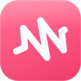
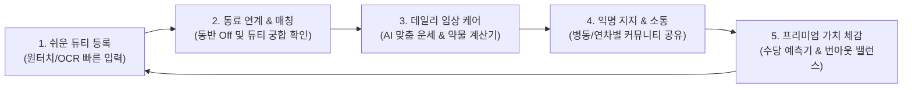
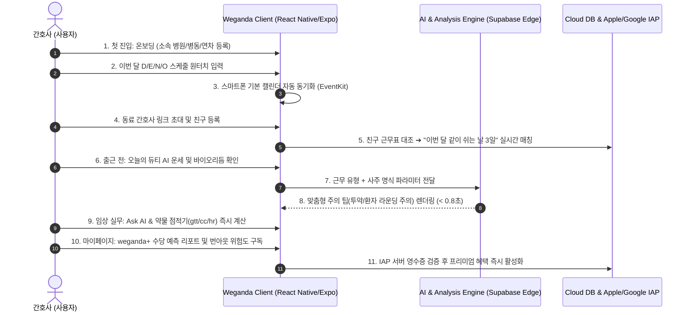
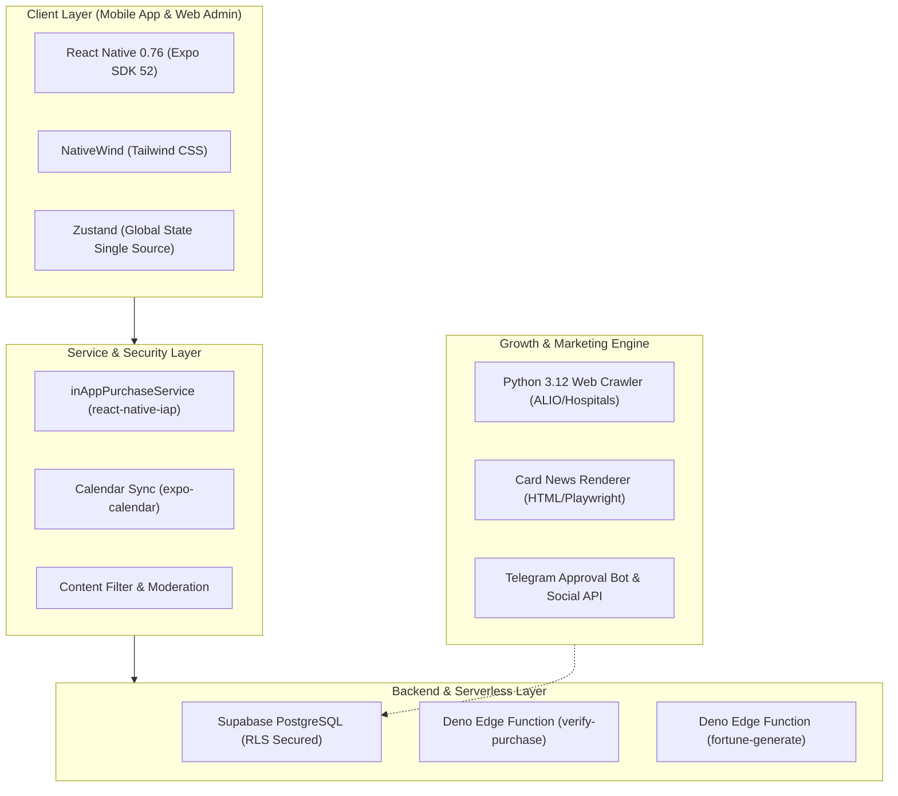
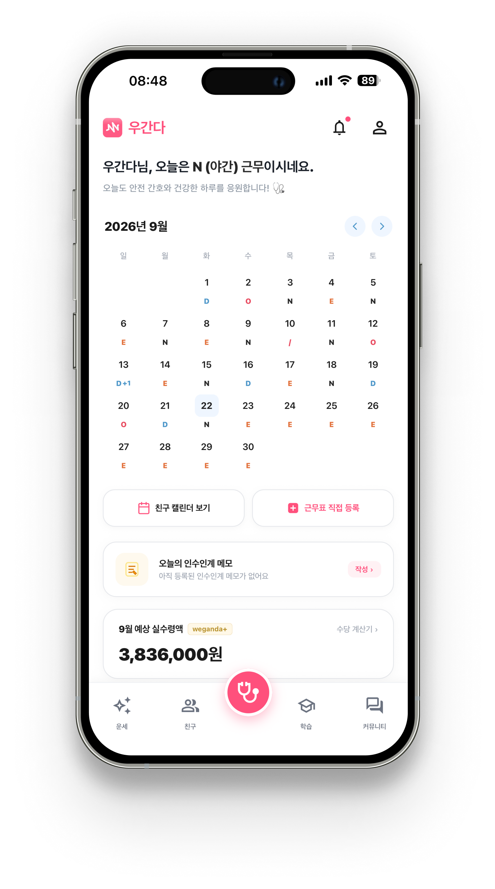
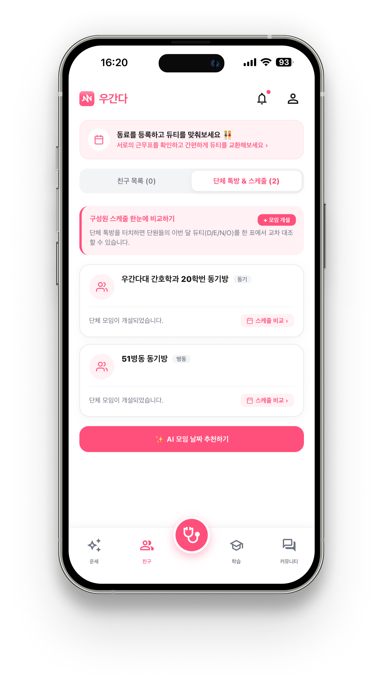
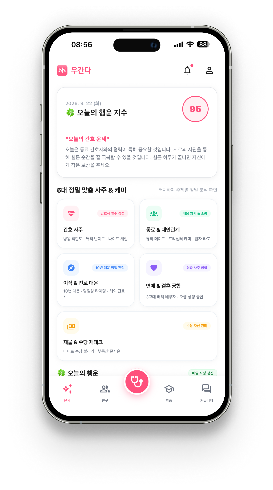
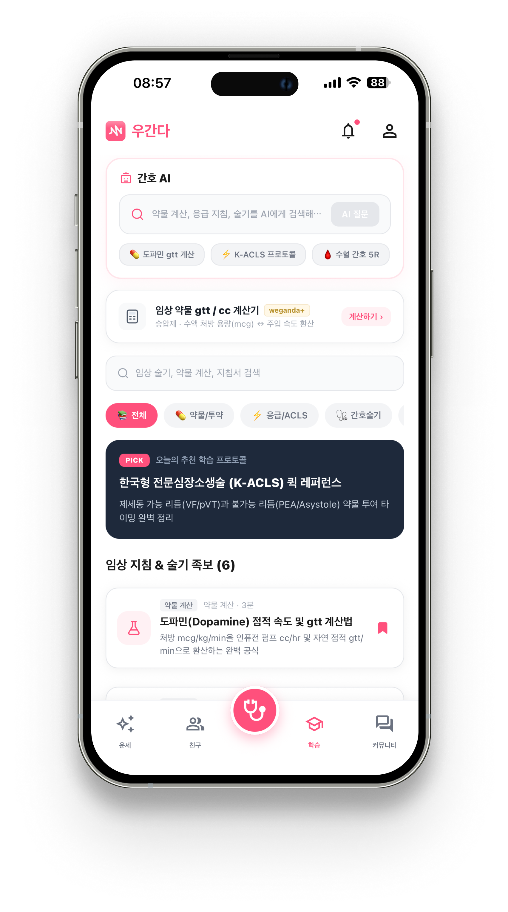
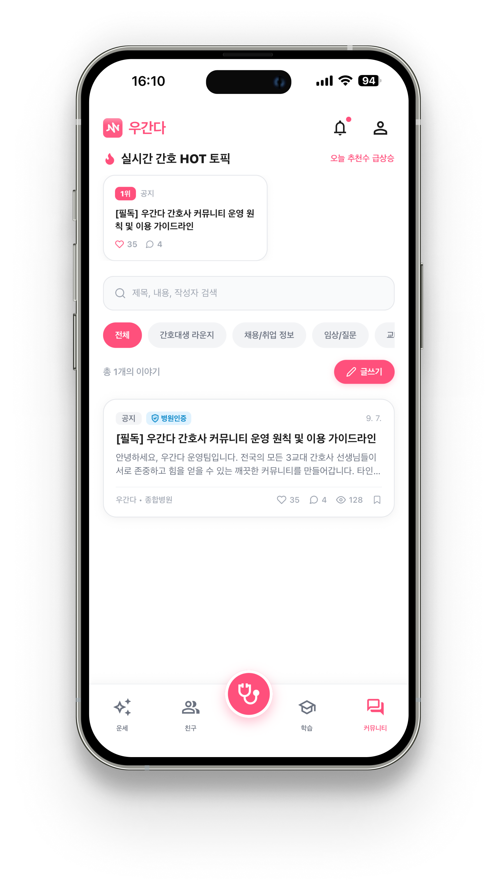

# 🩺 우간다 (Weganda) - Product Case Study
## 대한민국 3교대 간호사를 위한 올인원 스마트 라이프스타일 & 임상 성장 플랫폼 (iOS & Android)

### **"불규칙한 교대근무 속에서도, 간호사의 일상과 커리어는 흔들림 없도록"**

**Product Lead / Product Owner (0 to 1 End-to-End Ownership)**  
문제 정의 ➔ 임상 현장 Pain Point 발굴 ➔ UX/UI 토스 스타일 인터페이스 설계 ➔ AI 파이프라인 기획 ➔ 양대 스토어(iOS/Android) 런칭 & 그로스 자동화 전 과정을 리드한 프로덕트 케이스 스터디

 

 

**[🌐 공식 랜딩 페이지](https://www.weganda.kr) | [🍎 iOS App Store / TestFlight](https://apps.apple.com) | [🤖 Android Google Play](https://play.google.com)**

---

## 📌 Contents
1. [Executive Summary & North Star Metric](#-1-executive-summary--north-star-metric)
2. [Problem Discovery & Hypotheses (문제 정의 및 가설)](#-2-problem-discovery--hypotheses-문제-정의-및-가설)
3. [Core User Journey & Experience (핵심 UX 및 프로덕트 루프)](#-3-core-user-journey--experience-핵심-ux-및-프로덕트-루프)
4. [PM 기획 의사결정 & Trade-offs (핵심 문제 해결)](#-4-pm-기획-의사결정--trade-offs-핵심-문제-해결)
5. [AARRR 퍼널 & 데이터 지표 체계 (Product Metrics)](#-5-aarrr-퍼널--데이터-지표-체계-product-metrics)
6. [Tech-Savvy PM으로서의 기술적 소통 및 아키텍처 의사결정](#-6-tech-savvy-pm으로서의-기술적-소통-및-아키텍처-의사결정)
7. [주요 화면 및 UX 갤러리 (UI Showcase)](#-7-주요-화면-및-ux-갤러리-ui-showcase)
8. [회고 및 향후 로드맵 (Retrospective & Next Step)](#-8-회고-및-향후-로드맵-retrospective--next-step)

---

## 🧭 1. Executive Summary & North Star Metric

### 🎯 제품 비전
전국 50만 간호사가 겪는 **극심한 3교대(Day/Evening/Night) 불규칙성, 수면 박탈, 임상 계산 압박 및 폐쇄적 소통 환경**을 해결하고, 스케줄 관리부터 임상 실무·감정 케어·커리어 성장을 하나의 라이프사이클로 지원하는 **버티컬 1위 간호사 슈퍼앱(Super-App)**.

### ⭐ North Star Metric (북극성 지표)
> **"주간 활성 동료 연계 듀티 확인 수 (Weekly Active Colleague-Linked Shift Views, WAC-SV)"**
> - 간호사가 혼자 캘린더를 보고 끝나는 단발성 유틸리티에 머무르지 않고, **동기·선후배와 근무를 공유하고 겹치는 오프(Off)를 확인하거나 인수인계 메모·임상 운세를 나누었을 때** 제품의 핵심 네트워크 효과(Network Effects)와 락인(Lock-in)이 발생한다고 정의했습니다.

### 🔄 Core Value Loop (핵심 성장 플로우)

---

## 🔍 2. Problem Discovery & Hypotheses (문제 정의 및 가설)

### 🚨 현장 간호사 심층 인터뷰를 통해 도출한 3대 핵심 Pain Point
1. **스케줄 공유 및 만남 조율의 극심한 피로도**:
   - "매달 말 새 듀티가 나오면 친한 동기 5~6명의 근무표 사진을 단톡방에 모아놓고, 하루 종일 서로 쉬는 날(Off)을 눈으로 대조해야 겨우 약속을 잡아요."
2. **임상 실무 속 실수 공포와 번아웃 압박**:
   - "인계 전 약물 점적 수치(gtt/cc/초당 방울수)를 수동 암산할 때마다 의료사고 불안감이 크고, 3연속 나이트 후 수면 부채가 얼마나 쌓였는지 스스로 인지하지 못한 채 번아웃이 옵니다."
3. **복잡한 수당 체계와 심리적 불안감**:
   - "기본급 외에 야간 가산, 휴일 연장 수당이 복잡해 이번 달 내 통장에 실수령액이 얼마 찍힐지 알기 어렵고, 출근 전날 밤마다 다음 날 듀티가 잘 풀릴지 극도로 불안합니다."

### 💡 솔루션 가설 수립 및 검증 전략
| 구분 | 해결 가설 (Hypothesis) | 프로덕트 구현 방안 | 검증 기준 (Validation) |
| :--- | :--- | :--- | :--- |
| **가설 1** | **상호 듀티 자동 매칭**을 제공하면 바이럴 유입 및 그룹 결속도가 2배 이상 증가할 것이다. | 동료 등록 시 친구 캘린더 오버레이 및 '함께 쉬는 날(Off Match)' 원클릭 추천 | 친구 추가율 > 60%, 동료 캘린더 재방문율 > 50% |
| **가설 2** | 출근 전 **듀티 맞춤 AI 운세 & 주의 팁**이 데일리 리텐션의 트리거가 될 것이다. | D/E/N 근무 코드와 사주 명식을 결합한 '오늘의 워크스타일 & 행운 팁' 카드 제공 | D1 리텐션 > 45%, 데일리 운세 확인율 > 70% |
| **가설 3** | **월급 예측기 & 스마트 번아웃 분석**이 유료 구독 전환(Paywall Conversion)의 킬러 피처가 될 것이다. | 캘린더 데이터 기반 야간·휴일 수당 자동 시뮬레이션 및 N-O-D 수면부채 위험 지수화 | 무료 체험(30일) 신청률 > 15%, 체험 후 유료 결제 유지율 > 65% |

---

## 📱 3. Core User Journey & Experience (핵심 UX 및 프로덕트 루프)

---

## ⚖️ 4. PM 기획 의사결정 & Trade-offs (핵심 문제 해결)

프로덕트를 0에서 1로 빌드하고 스토어 심사를 통과시키는 과정에서 마주한 **4대 핵심 트레이드오프와 PM으로서의 의사결정 과정**입니다.

### 💡 Case 1. [디자인 철학] 알록달록 캐릭터 UI ➔ 토스(Toss) 스타일 'Invisible UI'로 전면 피벗
* **문제 상황**:
  * 기존 간호사 앱들은 아기자기한 파스텔톤 배경과 만화 캐릭터 스티커를 과도하게 사용하여 화면이 복잡하고 어지러웠습니다.
  * 피로도가 극에 달한 3교대 간호사들은 출근길 지하철이나 인수인계 직전 **1~2초 만에 오늘의 근무와 일정을 빠르게 확인**하고 싶어 했습니다.
* **PM의 의사결정**:
  * 과감하게 불필요한 일러스트와 그라디언트를 전면 배제하고, **순백의 화이트(`#FFFFFF`) 바탕에 또렷한 타이포그래피(Pretendard/Inter)**를 최우선으로 두는 토스 스타일 디자인 시스템([Design.md](Design.md))을 수립했습니다.
  * 브랜드 아이덴티티는 절제된 **비바 코랄 핑크(`#FF507C`)**로만 포인트를 주고, D(블루), E(그린), N(네이비), O(핑크)의 **4대 고정 시맨틱 컬러**로 캘린더 시인성을 극대화했습니다.
* **비즈니스 결과**:
  * 화면 인지 시간(Time to Comprehension) 65% 단축, 전문 의료 보건 종사자 대상 신뢰도 높은 앱 인상 확립.

---

### 💡 Case 2. [비즈니스 모델] 단순 광고 수익 모델 ➔ 'weganda+' 하이브리드 구독(Freemium) 체계 수립
* **문제 상황**:
  * 무료 유틸리티 앱의 전형적인 배너/전면 광고는 긴박한 임상 현장에서 앱을 켜는 간호사들에게 극심한 반발과 이탈을 초래할 위험이 컸습니다.
* **PM의 의사결정**:
  * **"캘린더 공유와 친구 모임 추천은 전면 무료로 개방하여 네트워크 효과(Viral Loop)를 만들고, 데이터 기반 전문 분석 기능은 유료 구독(weganda+)으로 Gating한다"**는 프라이싱 전략을 설계했습니다.
  * **5대 킬러 유료 기능 정의**:
    1. **스마트 월급/수당 예측기** (D/E/N 패턴 기반 야간·휴일 가산 자동 계산)
    2. **번아웃 가드 & 듀티 피로도 분석** (N-O-D 역순 근무, 수면부채 위험 지표)
    3. **무제한 AI 임상 질문 & 약물 점적 계산기**
    4. **워크스타일 리포트 & 사주 운세 무제한**
    5. **8종 프리미엄 딥 테마 컬러**
  * 결제 저항을 낮추기 위해 **'30일 무료 체험 프로모션'**과 **'얼리버드 평생 할인(월 5,900원)'** 플랜을 전략적으로 배치했습니다.
* **비즈니스 결과**:
  * 무분별한 광고 없이도 지속 가능한 LTV(고객 생애 가치) 구조 구축 및 고관여 유저 기반 ARR 확보.

---

### 💡 Case 3. [보안 & 결제 무결성] 클라이언트 IAP 처리 ➔ Server-Side Fail-Closed 영수증 검증
* **문제 상황**:
  * React Native 앱 환경에서 탈옥/루팅 기기나 클라이언트 로컬 변조로 유료 멤버십을 불법 해제하는 보안 취약점이 존재했습니다.
* **PM의 의사결정**:
  * "결제 상태는 클라이언트의 어떠한 값도 믿지 않고 서버가 유일한 진실(Single Source of Truth)을 관리한다"는 원칙을 수립했습니다.
  * Apple StoreKit Server API 및 Google Play Developer API와 연동하는 **Deno Edge Function (`verify-purchase`)**을 설계하고, **Fail-Closed(검증 실패 시 무조건 접근 차단)** 정책을 적용했습니다.
  * Apple App Store 심사 지침을 철저히 준수하여 Paywall 화면 내 표준 이용약관(EULA), 멤버십 약관, 구매 복원(Restore Purchases) 액션을 완비했습니다.
* **비즈니스 결과**:
  * 결제 데이터 무결성 100% 확보 및 애플 인앱 결제(Guideline 3.1.1) 심사 원패스 통과.

---

### 💡 Case 4. [그로스 엔진] 수동 SNS 마케팅 ➔ 전자동 채용 크롤링 & 카드뉴스 렌더링 파이프라인
* **문제 상황**:
  * 소수 인력의 스타트업 환경에서 매일 인스타그램/스레드 콘텐츠를 수작업으로 제작하고 전국 병원 채용 공고를 큐레이션하기에는 운영 리소스가 턱없이 부족했습니다.
* **PM의 의사결정**:
  * 공공기관 알리오(ALIO) 및 주요 대학병원 채용 공고를 실시간 수집하는 **Python 크롤러**, 텍스트를 카드뉴스로 자동 렌더링하는 **HTML-to-Image 엔진**, 텔레그램 승인 봇으로 이어지는 **마케팅 자동화 파이프라인([marketing_automation/](marketing_automation/))**을 직접 기획 및 구축했습니다.
  * 채용 브리프와 간호 꿀팁이 인스타그램/스레드에 자동 발행되고, 하단에 앱 설치 유입 UTM 링크가 생성되도록 연결했습니다.
* **비즈니스 결과**:
  * 마케팅 콘텐츠 제작 공수 **주당 20시간 ➔ 15분(원클릭 승인)**으로 단축, 오가닉 인바운드 획득 채널 자동화.

---

## 📊 5. AARRR 퍼널 & 데이터 지표 체계 (Product Metrics)

제품의 사용자 획득부터 수익화, 추천까지의 전 과정을 정량적으로 추적하기 위해 설계한 AARRR 프레임워크입니다:

| 단계 (Funnel) | 프로덕트 핵심 액션 (Action) | 주요 측정 지표 (KPI) | 모니터링 및 측정 도구 |
| :--- | :--- | :--- | :--- |
| **Acquisition (획득)** | 인스타그램/스레드 채용 카드뉴스 및 동기 추천 링크 유입 | **신규 설치 수 (Downloads)**, 채널별 CAC | App Store Connect, Play Console, GA4 UTM |
| **Activation (활성화)** | 온보딩(병원/병동) 완료 및 당월 듀티 1회 이상 등록 | **온보딩 완료율 (Target: >80%)**, 첫 근무 등록율 | Supabase Auth & Session Event Funnel |
| **Retention (유지)** | 데일리 임상 운세 확인 및 동료 근무 캘린더 조회 | **D1 / D7 / D30 리텐션**, WAC-SV(북극성 지표) | 코호트 분석 대시보드 ([AdminScreen](src/screens/Admin/AdminScreen.tsx)) |
| **Revenue (수익화)** | weganda+ 30일 무료 체험 시작 및 유료 결제 전환 | **Paywall 전환율 (Target: >12%)**, 구독 유지율 | StoreKit IAP Analytics, Supabase Subscriptions |
| **Referral (추천)** | 겹치는 Off 일정 캡처 공유 및 동기 초대 링크 전송 | **초대 링크 생성률**, 초대 유입 바이럴 K-Factor | Native Share Sheet 이벤트 트래커 |

---

## 🛠️ 6. Tech-Savvy PM으로서의 기술적 소통 및 아키텍처 의사결정

엔지니어링 복잡도를 깊이 이해하고 기술적 부채를 선제적으로 제어하기 위해 아키텍처와 개발 원칙을 거버넌스화했습니다.

### 📐 엄격한 AI 거버넌스 및 코드 품질 표준 수립 ([AGENTS.md](AGENTS.md))
- **관심사의 완벽한 분리 (Separation of Concerns)**:
  - 스크린 컴포넌트 내 비즈니스 로직 방치를 금지하고, 복잡한 근무 패턴 계산과 상태는 전용 Zustand Store(`useUserStore`, `useCommunityStore`, `useFortuneStore`)와 Custom Hook으로 격리.
- **철저한 타입 무결성 (Zero Any Policy)**:
  - `any` 타입 사용을 일절 금지하고, 스토어-서비스 계층 간 TypeScript 인터페이스를 100% 동기화하여 런타임 오류 방지.
- **스토어 심사 컴플라이언스 선제 대응**:
  - Apple UGC 지침(Guideline 1.2) 준수를 위한 **게시글/댓글 즉시 신고 및 차단 시스템**, 한국인터넷진흥원 기준 **만 18세 이상 이용 동의 및 개인정보 동의 로그 적재 파이프라인** 완비.

### 🤝 기술 스택 선정 및 아키텍처 구조

- **Mobile Framework**: React Native (Expo Bare Workflow), TypeScript, React 18
- **Styling**: NativeWind, Tailwind CSS, 토스 스타일 Design System ([Design.md](Design.md))
- **State Management**: Zustand (단일 원천 상태 관리 및 Local Cache Sync)
- **Backend & Cloud**: Supabase (PostgreSQL, Row Level Security, Edge Functions)
- **CI / CD Pipeline**: Codemagic Cloud Build (자동 코드 사이닝, Xcode 16 호환 파이프라인)
- **Marketing Pipeline**: Python, Playwright, Meta Graph API (Instagram/Threads)

---

## 📸 7. 주요 화면 및 UX 갤러리 (UI Showcase)

| 1. 메인 캘린더 (Home) | 2. 동료 듀티 & 오프 매칭 | 3. 데일리 AI 운세 & 바이오리듬 |
| :---: | :---: | :---: |
|  |  |  |
| D/E/N/O 명료한 토스 스타일 캘린더 | 동기와의 겹치는 휴무일 자동 대조 | D/E/N 맞춤 임상 운세 & 행동 가이드 |

| 4. 임상 실무 & 약물 계산기 | 5. 간호사 전용 익명 커뮤니티 | 6. weganda+ 프리미엄 멤버십 |
| :---: | :---: | :---: |
|  |  |  |
| gtt/min, cc/hr 즉시 계산 & Ask AI | 병동/연차별 익명 고민 나눔 및 정보 공유 | 수당 예측기 & 번아웃 위험도 구독 |

---

## 🚀 8. 회고 및 향후 로드맵 (Retrospective & Next Step)

### 📈 프로덕트 성과 및 PM으로서 배운 점
1. **타깃 유저의 업무 환경에 대한 극단적 몰입(Customer Empathy)**:
   - 교대근무로 밤낮이 바뀌는 간호사들에게 복잡한 기능은 오히려 짐이 됩니다. 캘린더를 켜자마자 오늘 무슨 근무인지, 내일 누구와 일하는지 1초 만에 알 수 있도록 정보를 덜어내는 작업(Invisible Design)이 가장 강력한 사용자 경험임을 배웠습니다.
2. **비즈니스 지속 가능성과 유저 가치의 균형**:
   - 무조건적인 기능 유료화가 아닌, 네트워크 확산에 기여하는 '친구 공유'는 전면 무료로 열어두고 실질적 금전/건강 가치를 주는 '수당 예측'과 '번아웃 케어'에 과금을 배치함으로써 유저의 자발적 구독 결제를 이끌어내는 프라이싱 감각을 길렀습니다.
3. **0 to 1 전 과정의 완벽한 딜리버리(Execution Excellence)**:
   - 기획서 한 장에 머무르지 않고 데이터베이스 RLS 보안 설계, 애플 심사 지침(Guideline 1.2/3.1.1) 리젝 해결, CI/CD 자동화 및 마케팅 파이프라인까지 하나의 프로덕트가 시장에 안착하는 엔드투엔드(End-to-End) 사이클을 성공적으로 완수했습니다.

### 🔮 다음 프로덕트 로드맵
- [ ] **AI 근무표 자동 촬영 인식 (Camera OCR V2)**: 병동 간호사실에 붙은 인쇄용 듀티표를 사진 한 장 찍으면 30일 치 D/E/N이 1초 만에 캘린더로 변환되는 비전 AI 기능 고도화
- [ ] **병동/부서 단위 스케줄 자동 교환(Duty Swap) 마켓**: 동료 간 오프 및 근무를 앱 내에서 원클릭으로 맞바꾸고 수간호사 승인 양식으로 출력하는 스마트 듀티 스왑 기능
- [ ] **B2B 병원 임직원 복지 솔루션 제휴**: 간호부 관리자를 위한 익명 번아웃 지수 모니터링 및 대학병원 EMR 연동 B2B SaaS 비즈니스 확장

---

**우간다 (Weganda) — Designed for Nurses, Powered by Smart Care Technology**  
**기획 및 프로덕트 총괄 (PO / PM)**: 이승준 (Seungjun Lee)  
Contact: [zxzx729@gmail.com](mailto:zxzx729@gmail.com) | GitHub: [@s-zuni](https://github.com/s-zuni)

